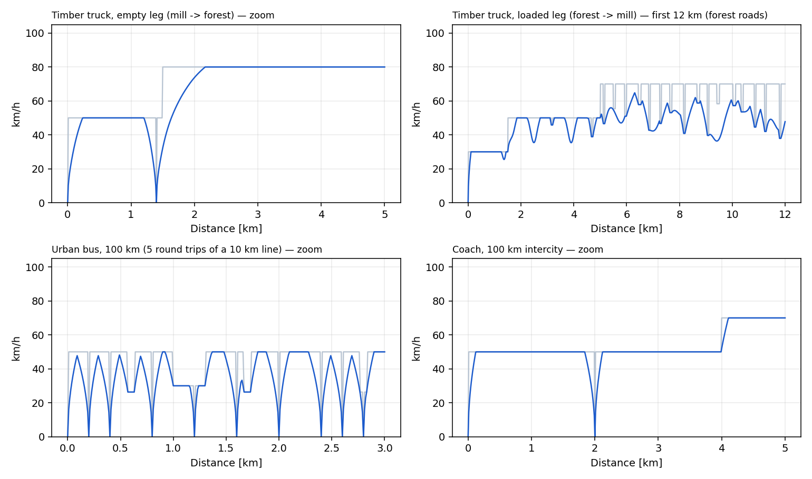
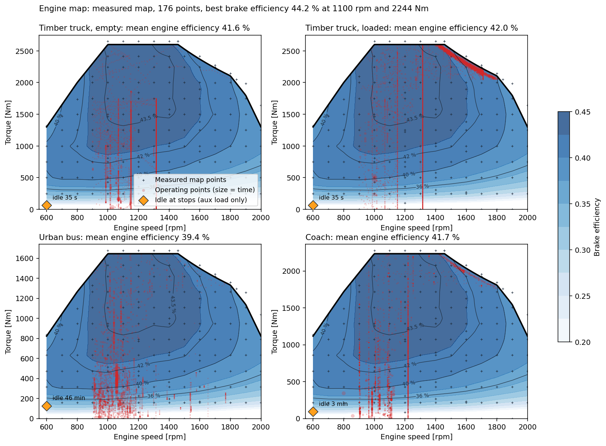

# mini-VECTO

A small, transparent energy-use simulator for heavy-duty vehicles. It compares five powertrains on the same missions (a 100 km timber-truck route both ways, and the VECTO Urban and Coach cycles for the buses) and returns the fuel, hydrogen or electricity used **every 10 metres**, plus the mission average.

Built by Filippo Cinquini, master's student at Chalmers University of Technology, as a supporting tool for coursework in **TRA545 Hydrogen Technologies**: the course project needed a vehicle energy model and none was available, so this one was written from public sources.

> **Status: work in progress.** This is a student model, not a validated engineering tool. Many inputs are assumptions (they are marked as such). It is an independent personal project, not affiliated with or endorsed by Chalmers or any vehicle manufacturer; manufacturer names appear only as sources of public data.



## What it does

| Powertrains | Missions |
|---|---|
| Diesel | Timber truck, empty leg, 20 t, 100 km synthetic route |
| HVO100 | Timber truck, loaded leg, 74 t, same route reversed |
| Hydrogen engine (HPDI with HVO100 pilot) | Urban bus, 12.8 t (12 passengers), VECTO Urban cycle, 39.6 km |
| Fuel cell electric | Coach, 17.0 t (37 passengers), VECTO Coach cycle, 91.7 km |
| Battery electric | |

The method follows the logic of VECTO, the EU tool for heavy-duty CO2 certification: a **backward** simulation on a **distance-based** cycle.

```
route (speed limit, grade, surface)
  -> driver model            speed really driven
  -> wheel force             inertia + grade + rolling resistance + air drag
  -> powertrain              gearbox -> engine map            (Diesel, HVO100, H2 engine)
                             gearbox -> motor -> battery      (battery electric)
                             gearbox -> motor -> fuel cell + buffer battery
  -> consumption per 10 m step and per mission
```

## Quick start

You need Python 3.9 or newer.

```bash
git clone https://github.com/filippocinquini/mini-vecto.git
cd mini-vecto
python3 -m pip install -r requirements.txt
python3 run_all.py
```

The run takes under a minute and prints a table like this (measured engine map, the default; see [Engine map](#engine-map-two-options)):

```
Mean consumption per 100 km
mission         Diesel l   HVO l  H2-ICE kg   FCEV kg new/aged  BEV kWh (battery)
timber_empty        33.3    34.6        9.3          7.5 / 9.6                154
timber_loaded       75.1    78.0       21.6        16.0 / 20.3                278
urban_bus           34.9    36.2        9.6          5.7 / 7.4                112
coach               28.1    29.2        7.9          6.0 / 7.6                113
```

On macOS or Windows you can also double click `RUN_MODEL_mac.command` or `RUN_MODEL_windows.bat`. A step-by-step guide is in [docs/QUICK_START.pdf](docs/QUICK_START.pdf).

## Driving cycles

Timber truck: a synthetic 100 km route (road classes, curves, grades and stops from Swedish data, `missions.py`), driven empty one way and loaded back.

Buses (since 0.3.0): the **VECTO** standard bus cycles, so that the results can be compared with VECTO and with studies that use the same cycles. Base case: urban bus on **VECTO Urban**, coach on **VECTO Coach**; VECTO Heavy Urban and Suburban, and the synthetic routes used up to 0.2.1, are kept as a sensitivity (`cycle_sensitivity.py`, `results/cycle_sensitivity.csv`). The cycle files (`<s>,<v>,<grad>,<stop>`, the VECTO Declaration mission cycles) were provided by AB Volvo for the course; they are not redistributed here. Put them in `data/private/vecto_cycles/` (Urban.csv, Coach.csv, HeavyUrban.csv, Suburban.csv) to reproduce the base case; without them the synthetic bus routes are used.

| Mission | Cycle | km | Mean speed [km/h] | Stops per km | Climb [m per 100 km] | Diesel [l/100 km] | H2-ICE [kg/100 km] | FCEV new / aged [kg/100 km] | BEV [kWh/100 km] |
|---|---|---|---|---|---|---|---|---|---|
| urban_bus | VECTO Urban | 39.6 | 17.6 | 3.06 | 727 | 34.9 | 9.6 | 5.7 / 7.4 | 112 |
| urban_bus_heavyurban | VECTO HeavyUrban | 30.5 | 12.3 | 5.08 | 689 | 43.1 | 11.8 | 6.9 / 8.9 | 135 |
| urban_bus_suburban | VECTO Suburban | 23.5 | 27.4 | 1.87 | 315 | 32.5 | 9.1 | 5.4 / 6.9 | 99 |
| urban_bus_synthetic | synthetic (up to 0.2.1) | 100.0 | 17.1 | 2.91 | 487 | 42.4 | 11.9 | 6.5 / 8.4 | 122 |
| coach | VECTO Coach | 91.7 | 65.3 | 0.07 | 838 | 28.1 | 7.9 | 6.0 / 7.6 | 113 |
| coach_synthetic | synthetic (up to 0.2.1) | 100.0 | 78.4 | 0.05 | 580 | 25.1 | 7.0 | 5.9 / 7.5 | 115 |

## Outputs

| File | Content |
|---|---|
| `results/consumption_<powertrain>.xlsx` | One workbook per powertrain: a Summary sheet (mean consumption, live formulas), one sheet per mission with one row every 10 m, and a Notes sheet with parameters and sources |
| `consumption_*.csv` | The same step data as plain CSV, ready for emission factors |
| `index.html` | Mission explorer: speed, altitude, grade and road surface along each route. Open it in a browser |
| `fig_*.png` | Mission profiles and engine operating points |

Generated files are not stored in the repository; `run_all.py` recreates them.

## Engine map: two options

The engine powertrains (Diesel, HVO100, hydrogen engine) read the fuel use from an engine map. `vehicles.json` > `engine_map` > `source` selects which one:

| `source` | What it is | Best brake efficiency |
|---|---|---|
| `"model"` | Semi-empirical map: friction model plus an assumed indicated-efficiency shape | 50 % (assumption) |
| `"measured"` (default) | Steady-state test-bench map of a 13 L heavy-duty diesel engine, 176 operating points, provided by AB Volvo for the TRA545 course project. Fuel flow is interpolated linearly in torque and speed | 44 % (BSFC 191 g/kWh) |

The measured map is in [`data/engine_map_measured.csv`](data/engine_map_measured.csv): one row per test-bench point with speed, torque, fuel flow, BSFC and engine-out emissions and heat flows. `import_engine_map.py "path/to/file.xlsx"` rebuilds it from the original Excel file (or from another engine's map in the same layout). If the file is missing, the model map is used and the run says so.

`python3 run_all.py --engine-map model` (or `measured`) overrides the setting for one run, and `python3 compare_engine_maps.py` runs both and writes `results/engine_map_comparison.csv`:

| Diesel [l/100 km] | Model map (50 %) | Measured map (44 %) | Change |
|---|---|---|---|
| Timber truck, empty | 31.9 | 33.3 | +4 % |
| Timber truck, loaded | 67.1 | 75.1 | +12 % |
| Urban bus | 41.4 | 42.4 | +3 % |
| Coach | 23.8 | 25.1 | +6 % |
| Idle, timber truck [l/h] | 2.8 | 2.2 | −21 % |

HVO100 and the hydrogen engine move by the same percentages, because they use the same map. Fuel cell and battery results do not change.

Read the two maps as a range, not as right and wrong: the 50 % peak is an assumption for a modern engine, and the measured engine was tested in 2019 (its exact engine model is not stated in the file). With the measured map the loaded timber truck (75 l/100 km) is above the fleet range measured by Noreland (52–69), while the empty leg and idle fuel get closer to it.

## Change the vehicles

All vehicle data are in [`vehicles.json`](vehicles.json). Edit a number, save, run again.

| What | Section | Keys |
|---|---|---|
| Mass, drag, rolling resistance | `missions` > mission | `mass_kg` (timber) or `curb_kg` + `n_pax` x `kg_per_pax` (buses), `CdA_m2`, `cr_asphalt`, `cr_gravel` |
| Engine size and power | `vehicles` > vehicle > `engine` | `rated_power_kW`, `displacement_l` |
| Axle ratio, tyre radius, auxiliaries | `vehicles` > vehicle | `axle_ratio`, `tyre_dynamic_radius_m`, `aux_mech_kW` |
| Gear ratios | `gearboxes` | `ratios`, `eta_indirect`, `eta_direct` |
| Fuels, pilot share of the hydrogen engine | `fuels`, `hpdi` | `LHV_MJ_per_kg`, `pilot_share_full_load` |
| Electric motor | `electric` > `vehicles` > vehicle | `motor_peak_kW`, `n_gears`, `aux_el_kW` |
| Battery (battery electric) | `electric` > `vehicles` > vehicle > `bev` | `battery_kWh`, `soc_start`, `extra_mass_kg` |
| Fuel cell and buffer battery | `electric` > `vehicles` > vehicle > `fcev` | `fc_net_kW`, `battery_kWh`, `extra_mass_kg` |
| Fuel cell efficiency curve | `electric` > `fuel_cell` | `eta_sys_BOL`, `eta_sys_EOL`, `min_load_frac` |

Routes (length, speed limits, stops, hills) are defined in `missions.py`, section `MISSIONS`.

The engine map scales with `displacement_l`, while `rated_power_kW` limits the speed profile: change both in proportion (the reference is 397 kW for 12.8 L).

## Repository layout

| File | Role |
|---|---|
| `run_all.py` | Runs everything in order |
| `missions.py` | Routes and driver model; writes the cycles |
| `powertrain.py` | Diesel, HVO100 and hydrogen engine |
| `import_engine_map.py` | Converts a measured engine map (Excel) into the CSV the model reads |
| `compare_engine_maps.py` | Runs the engine powertrains with both engine maps |
| `electric.py` | Battery electric and fuel cell electric |
| `export_excel.py` | Builds the Excel workbooks |
| `plot_operating_points.py` | Engine operating points figure |
| `build_site.py` | Packs the cycles for `index.html` |
| `vehicles.json` | All vehicle and powertrain data |
| `cycle_*.csv`, `data/` | The four mission cycles (kept so `index.html` works without running anything) |
| `docs/` | Quick-start guide, reference list, figures |

## How the model compares with published data

| Quantity | Model, measured map (model map) | Literature | Source |
|---|---|---|---|
| Diesel, loaded timber truck [l/100 km] | 75.1 (67.1) | 52–69 | Noreland 2025, measured fleet |
| Diesel, empty timber truck [l/100 km] | 33.3 (31.9) | 34–47 | Noreland 2025, measured fleet |
| Idle fuel [l/h] | 2.2 (2.8) | about 2.4 | Noreland 2025 |
| Fuel cell bus [kg H2/100 km] | 5.7–7.4 (VECTO Urban), 6.9–8.9 (Heavy Urban) | 7.7 | JIVE 2, measured, 12 m buses |
| Electric timber truck, loaded / empty [kWh/km] | 2.78 / 1.54 | 2.5 / 1.5 | Skogforsk 2023, planning values |

Fuel cell range = new to aged stack. Electric results do not depend on the engine map.



How to read the figure: the orange diamond is idle at the stops (vehicle standing, clutch open, 600 rpm, torque = auxiliary load only). The red vertical lines are steady cruising in top gear: with the clutch closed the engine speed is fixed by the vehicle speed (n = v · i_gear · i_axle / (2π r)), e.g. coach 100 km/h = 1220 rpm, truck 80 km/h = 1320 rpm, bus 50 km/h = 1300 rpm, and the torque changes with the grade; on gentle downhills it falls to the auxiliary load (near 0 Nm). Steps with the engine dragged by the vehicle (overrun, fuel cut-off, 0 fuel) are not drawn. The measured points at 0 Nm are test-bench points with zero brake torque (engine firing).

## Known limits

- The measured map (default) is of a 13 L diesel engine tested in 2019; the file does not state the exact engine model, and its test fuel is assumed to be standard diesel (42.7 MJ/kg). The alternative semi-empirical map (friction model plus an assumed indicated-efficiency shape, scaled to a 50 % peak) is an assumption.
- HVO100 and the hydrogen engine use the diesel map (equal efficiency). For hydrogen this is an assumption, not a measurement.
- With the measured map, engine torque above the highest measured point of a speed line is extrapolated (14 % of the fuel of the loaded timber truck, 3 % or less elsewhere).
- Battery-electric and fuel cell vehicles carry `extra_mass_kg`, the hydrogen engine `h2ice_mass` > `extra_mass_kg` (net of the removed diesel parts; arithmetic in `mass_breakdown_kg`, references in `electric` > `mass_sources`). Diesel and HVO100 use the diesel vehicle mass; the hydrogen engine is simulated in a second run (`consumption_h2ice_<mission>.csv`). The loaded timber leg has `max_gross_kg` = 74 t (Swedish BK4): the gross mass stays at the limit and the extra mass reduces the payload (`payload_kg` and `timber_t_per_round_trip` in the summaries; round-trip column of the Excel Summary). Open issue: motor and engine sizing should follow an equal power-to-mass rule (`power_to_mass_rule` in vehicles.json).
- The timber route is synthetic, not a GPS track. The bus cycles are the VECTO Urban and Coach cycles, driven with this model's driver (acceleration caps, not VECTO's driver model), so results are close to, not identical with, a VECTO run on the same cycle.
- On the VECTO Coach cycle the battery-electric coach (19.3 t, 340 kW) cannot follow the steepest climbs in 505 of 9 173 steps (motor at its limit); see `power_to_mass_rule` in vehicles.json.
- Gear shifting is ideal (lowest fuel use at each step); there is no engine start-stop.
- Fuel cell energy management: when the buffer battery cannot take more charge, the fuel cell backs off first (down to its minimum load, ramp limited) and only then is regeneration reduced. The buffer-battery charge limit (3C, 210 kW on the timber truck) is an assumption and is now the limit on regeneration of the loaded timber leg (67 % of the braking energy recovered); with 5C the hydrogen use of that leg falls by only 0.3 %.
- Several fuel cell and electric-drive inputs are assumptions: part-load points of the efficiency curve, minimum load, ramp rate, DC/DC losses, regeneration limits, bus and coach component sizes.
- No cabin heating model, and no crane work for the timber truck.

Each assumption is flagged in the `notes` of `vehicles.json` and in the Notes sheet of the workbooks.

## References

The full list, with what was taken from each source, is in [docs/REFERENCES.md](docs/REFERENCES.md). The main ones:

- European Commission, VECTO, and Regulation (EU) 2017/2400.
- Noreland (2025), Skogforsk Arbetsrapport 1247-2025: driver model, resistances and measured fuel use of Swedish timber trucks.
- Grunditz and Thiringer (2017), Chalmers Technical Report 2017:1: electric drive loss modelling.
- Gibbons and Kleen (2026), DOE Hydrogen Program Record 26002; Wang and Ahluwalia (2025), *Energies*: fuel cell system efficiency when new and aged.
- Skogforsk Arbetsrapport 1176-2023: electric timber truck planning values.

## Authors

Filippo Cinquini, Chalmers University of Technology, 2026. See [CITATION.cff](CITATION.cff) to cite this work.

The model design, the choice of sources and the checks are mine; the code was written with the help of an AI assistant (Claude, Anthropic). Review it before relying on it.

## License

Code released under the [MIT License](LICENSE). Numbers taken from the cited sources remain the property of their authors.

## Dashboard

`python3 dashboard.py` (or double-click `OPEN_DASHBOARD_mac.command` / `OPEN_DASHBOARD_windows.bat`) opens a local page at
http://127.0.0.1:8765. Pick a mission at the top; every view follows it.

| View | What it shows |
|---|---|
| Overview | Energy per km of the five powertrains, mission figures, share of the energy that becomes traction, extra mass and friction braking |
| Mission | Live replay of the mission: speedometer, grade, and one instrument per powertrain (gear, rpm, torque, motor and battery power, fuel cell load, state of charge, fuel used so far); speed, altitude and wheel power along the route, with zoom or follow mode |
| Engine map | Interactive measured or semi-empirical map, coloured by efficiency, BSFC or engine-out NOx, with full-load curve, constant-power lines and every operating point of the mission; time in each gear |
| E-motor | Efficiency map of motor + inverter (motoring and regenerating) from the loss model, with operating points and the loss split (copper, iron, friction, inverter) at any point |
| Fuel cell | System efficiency against net power for a new and an aged stack (age slider), time spent at each load, hydrogen flow, and the power split between fuel cell and buffer battery |
| Battery | State-of-charge gauge and trace for the BEV battery and the FCEV buffer, C-rate distribution, regeneration |
| Compare | All missions side by side, native units, Excel workbooks and figures |
| Run & inputs | Edit the main values of `vehicles.json`, run `run_all.py` in the background with live progress; the dashboard refreshes when the run ends |

The player bar at the bottom drives every view: play/pause (space bar), jump ±30 s (arrow keys), drag the scrubber, choose the
replay speed. Light and dark appearance follow the system (button in the top bar to force one).

Editing inputs: saving writes `vehicles.json` and, on the first save, keeps the original as `vehicles.json.bak`
(**Restore original** puts it back). Only the fields listed in the dashboard can be changed there; everything else stays in
`vehicles.json` and `missions.py`. The server uses the Python standard library only, listens on your computer only, and can
just read the results, write those fields and launch `run_all.py`.
